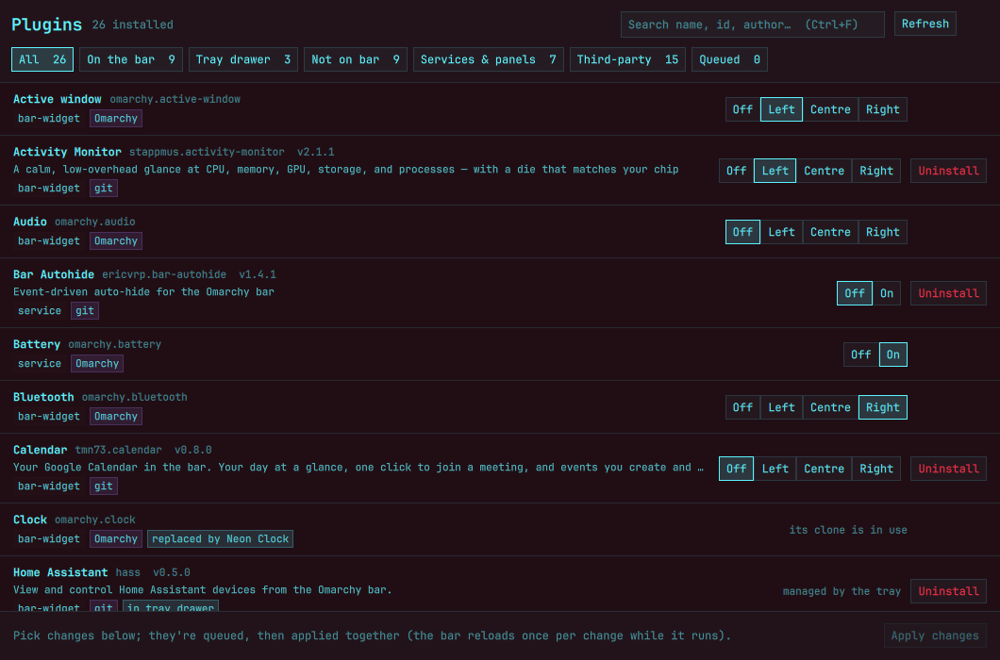
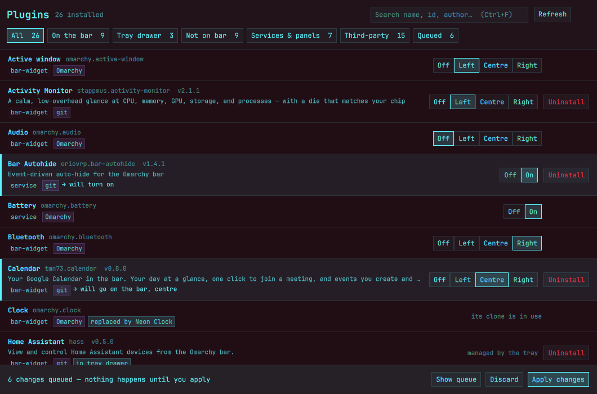
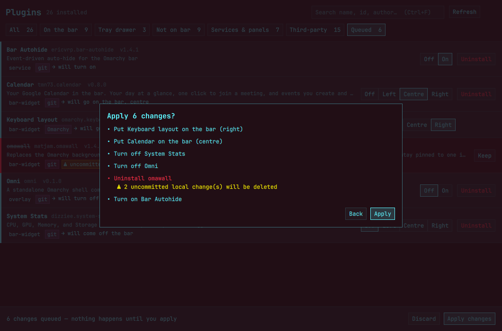
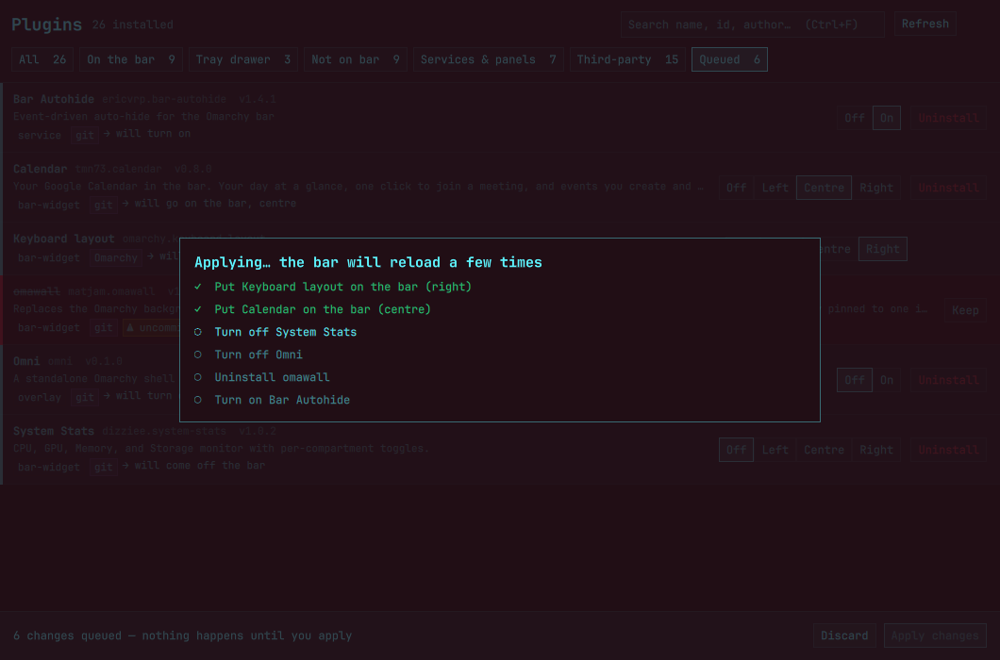

# Plugboard

A plugin manager for the [Omarchy](https://omarchy.org) shell that lets you
**queue up changes and apply them together**, in its own window.

Plugin managers that live in the bar close every time a change rebuilds the
bar, so working through a dozen changes means reopening the panel a dozen
times. Plugboard runs as a separate Quickshell process: pick everything you
want (bar placement, on/off, uninstall), press **Apply changes**, and watch
the queue run while the window stays put.



## What it does

- **Lists every plugin** — Omarchy's own and third-party — with where it
  lives: left / centre / right of the bar, the tray drawer, or off the bar.
  Filter by placement, kind or source, or search by name, id, author.
- **Queues changes, applies nothing until you say so.** Off / Left / Centre /
  Right for bar widgets, Off / On for services, panels and overlays, and
  Uninstall for third-party plugins. Queued rows say what will happen.

  

- **Checks before it deletes.** `omarchy plugin remove` deletes a git-managed
  plugin outright, so Plugboard fetches each one first and warns about
  uncommitted changes or commits that aren't on its remote. Plain folders are
  backed up rather than deleted, and symlinked dev plugins only unlinked.

  

- **Applies one change at a time through Omarchy's own CLI**
  (`omarchy plugin …`, `omarchy bar …`), waits for the shell to come back
  after each bar rebuild, then **reads the result back** from the system
  rather than trusting the exit code. A slow shell that times out but made
  the change counts as done; one that says "ok" and didn't is reported.

  

Each change still makes the shell rebuild the bar once — Plugboard just
stops that from being your problem. Collapsing them into one rebuild would
mean writing `shell.json` behind the shell's back, which it deliberately
doesn't do.

## Careful around

- **Tray-drawer widgets** (e.g. from
  [omarchy-tray](https://github.com/TyRichards/omarchy-tray)) read as
  *disabled* to the plugin registry, and the registry's disable path deletes
  the `plugins[]` entry that keeps a third-party drawer widget loaded. So
  drawer widgets get no on/off control here. Uninstalling one takes it out of
  the drawer (and its order list) first; uninstalling a drawer host warns how
  many widgets go with it. A drawer widget missing from `plugins[]` is flagged.
- **Clone originals.** If you've cloned a built-in (say `omarchy.clock` →
  your own clock), the original is marked *replaced by …* with no controls —
  `omarchy bar put` on it answers ok and does nothing.

It doesn't do marketplace browsing, updates or shortcuts; keep your other
plugin manager for those.

## Install

Needs Omarchy with the Quickshell-based shell (`omarchy-shell`), `qs` and
`python3` — all already there on a current install.

```bash
git clone https://github.com/Doghouse-Mike/plugboard ~/.local/share/plugboard
ln -s ~/.local/share/plugboard/bin/plugboard ~/.local/bin/plugboard
cp ~/.local/share/plugboard/plugboard.desktop ~/.local/share/applications/   # optional launcher entry
```

```bash
plugboard          # open, or raise the running window
plugboard --demo   # made-up plugins (demo/fixture.json); changes nothing
```

`Ctrl+F` searches, `Esc` closes dialogs, `Ctrl+Q` quits. Every apply is
logged to `~/.local/state/plugboard/apply.log`.

## How it's put together

- `app/` — the Quickshell UI. IPC target `plugboard`: `show`, `state`,
  `queue <id> <off|on|left|center|right|remove>`, `apply`, `confirm`,
  `discard`, `snapshot <png>` (handy for scripting and tests).
- `tools/state.py` — read-only snapshot: `omarchy plugin list --json`, plus
  placement from `~/.config/omarchy/shell.json` and each plugin's git state.
- `tools/removal-check.py` — what an uninstall would lose.
- `tools/apply.py` — runs the queue and reports each step as JSON lines.
- `tools/demo.py` — the `--demo` stand-in for all three.

## License

MIT
